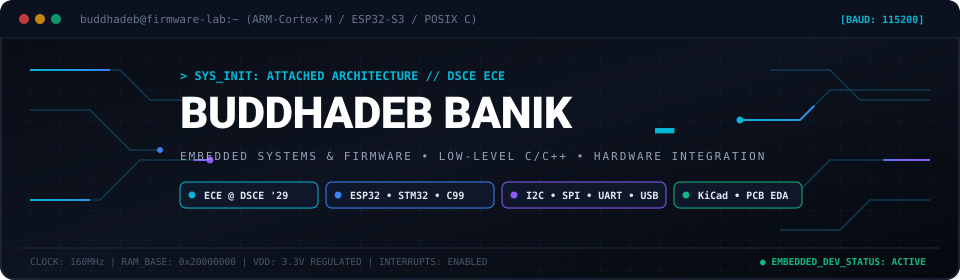
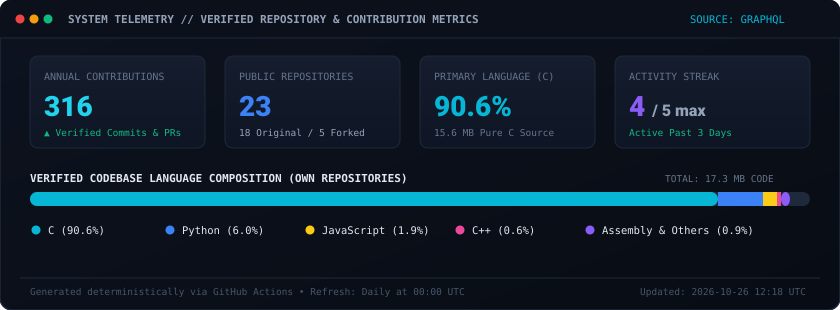
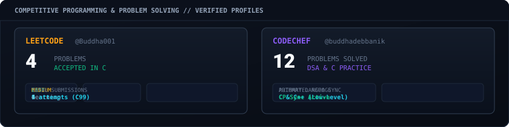

<!-- Custom Animated Cyber-Embedded Banner -->
<picture>
  <source media="(prefers-color-scheme: dark)" srcset="assets/banner.svg">
  
</picture>

<!-- Dynamic Typing Header -->

 

<!-- Authoritative Identity & Social Badges -->

  
  &nbsp;
  
  &nbsp;
  
  &nbsp;
  
  &nbsp;
  

<!-- Animated Oscilloscope Signal Waveform Divider -->

---

## ⚡ About Me

I am an **Electronics and Communication Engineering (ECE)** undergraduate at **Dayananda Sagar College of Engineering (DSCE)**, Bengaluru (2025–2029).

My technical work lives at the intersection of **silicon and software** — designing physical circuits and PCBs, bringing up bare-metal microcontroller firmware, and developing low-level systems software in pure C. Rather than treating hardware as an opaque abstraction, I enjoy inspecting register states, probing I2C and SPI bus lines on an oscilloscope, and optimizing execution down to the clock cycle.

- 🔬 **Hardware & Embedded:** Developing on **ESP32**, **STM32 (ARM Cortex-M)**, and **AVR** platforms; architecting sensor telemetry over **I2C, SPI, and UART**; designing custom multi-layer PCBs and schematics in **KiCad**.
- 💻 **Systems & Software:** Building POSIX-compliant tooling, custom shells, and automation in **C (C99/C11)** and **Python**; practicing rigorous Data Structures & Algorithms in pure C.
- 🎯 **Current Focus:** Hardware-software co-design, real-time sensor fusion, embedded telemetry instrumentation, and open-source systems engineering.

---

## 🛠️ Technical Stack & Engineering Toolkit

### 💻 Core Programming Languages

  
  
  
  
  
  

### 🔌 Embedded Systems, Microcontrollers & Protocols

  
  
  
  
  

### 📐 Electronics, EDA & Hardware Instrumentation

  
  
  
  

### ⚙️ Developer Tools, Build Systems & Infrastructure

  
  
  
  
  

---

## 🚀 Featured Engineering Projects

A curated selection of substantive projects built from actual code, hardware design, and systems engineering:

<table>
  <thead>
    <tr>
      <th width="30%">Project &amp; Repository</th>
      <th width="45%">Technical Scope &amp; Problem Addressed</th>
      <th width="25%">Technologies</th>
    </tr>
  </thead>
  <tbody>
    <tr>
      <td>
        <b><a href="https://github.com/Buddhadeb-ss/SIH-26-Anti-Drone-System">SIH-26-Anti-Drone-System</a></b> 
        Smart India Hackathon 2026
      </td>
      <td>
        Integrated counter-UAS (unmanned aerial system) defense architecture. Incorporates low-latency radar target tracking, dual-axis motorized gimbal actuation, embedded microcontroller firmware, and a real-time tactical command dashboard.
      </td>
      <td>
        <code>Embedded C</code> <code>Python</code> <code>Assembly</code> <code>Radar Interfacing</code> <code>Gimbal Control</code>
      </td>
    </tr>
    <tr>
      <td>
        <b><a href="https://github.com/Buddhadeb-ss/DC-voltage-meter">DC-voltage-meter</a></b> 
        Precision Energy Instrumentation
      </td>
      <td>
        IoT-enabled precision Direct Current (DC) power instrumentation monitor. Architected for DC renewable ecosystems, solar arrays, and battery cells. Measures Voltage, Current, instantaneous Power, and accumulated Energy in real-time with I2C sensor reading and OLED readout.
      </td>
      <td>
        <code>C++</code> <code>ESP32</code> <code>INA219 (I2C)</code> <code>SSD1306 OLED</code> <code>KiCad Schematics</code>
      </td>
    </tr>
    <tr>
      <td>
        <b><a href="https://github.com/Buddhadeb-ss/fruit-fly-learning">fruit-fly-learning</a></b> 
        Computational Neuroscience Simulation
      </td>
      <td>
        Connectome-based <i>Drosophila melanogaster</i> (fruit fly) brain learning model mapped into a simulated game environment. Explores whether biological synaptic connectivity networks can learn adaptive control behaviors in an artificial simulation.
      </td>
      <td>
        <code>Python</code> <code>Connectome Data</code> <code>Neural Simulation</code> <code>Algorithms</code>
      </td>
    </tr>
    <tr>
      <td>
        <b><a href="https://github.com/Buddhadeb-ss/ESP32-FIFA-Live-Scoreboard">ESP32-FIFA-Live-Scoreboard</a></b> 
        IoT Telemetry &amp; Environmental Workstation
      </td>
      <td>
        Real-time standalone football match scoreboard and workstation environmental monitor. Connects via WiFi to the football-data.org REST API, parses JSON payloads on-the-fly, triggers goal notifications, and simultaneously polls a BME280 sensor for temperature, humidity, and barometric pressure.
      </td>
      <td>
        <code>C++</code> <code>ESP32</code> <code>BME280 (I2C)</code> <code>SSD1306 OLED</code> <code>REST API</code>
      </td>
    </tr>
    <tr>
      <td>
        <b><a href="https://github.com/Buddhadeb-ss/Game-Development-board">Game-Development-board</a></b> 
        Custom Handheld Console Hardware
      </td>
      <td>
        Complete custom printed circuit board (PCB) designed in KiCad for a handheld gaming and embedded development console. Integrates an Arduino Nano ESP32, 0.96" I2C OLED display, and a 5-button tactile GPIO matrix with optimized trace routing and noise decoupling.
      </td>
      <td>
        <code>KiCad EDA</code> <code>PCB Layout</code> <code>Arduino Nano ESP32</code> <code>OLED I2C</code> <code>Gerber CAM</code>
      </td>
    </tr>
    <tr>
      <td>
        <b><a href="https://github.com/Buddhadeb-ss/codecrafters-shell-c">codecrafters-shell-c</a></b> 
        POSIX Shell from Scratch
      </td>
      <td>
        A POSIX-compliant command line interpreter built ground-up in standard C. Implements interactive REPL, command tokenization, executable path search via <code>PATH</code>, builtins (<code>cd</code>, <code>pwd</code>, <code>echo</code>, <code>type</code>, <code>exit</code>), and file descriptor redirection.
      </td>
      <td>
        <code>C (C99)</code> <code>POSIX APIs</code> <code>Process Fork/Exec</code> <code>Systems Programming</code>
      </td>
    </tr>
    <tr>
      <td>
        <b><a href="https://github.com/Buddhadeb-ss/coding-practice">coding-practice</a></b> 
        Automated CP &amp; DSA in Pure C
      </td>
      <td>
        Centralized competitive programming repository containing verified solutions written predominantly in C. Features automated webhook synchronization via CP-Sync across LeetCode, CodeChef, and Virtual Judge with standardized metadata headers and test verification.
      </td>
      <td>
        <code>C (C99/C11)</code> <code>Algorithms</code> <code>CP-Sync Automation</code> <code>GitHub API</code>
      </td>
    </tr>
  </tbody>
</table>

  <a href="https://github.com/Buddhadeb-ss?tab=repositories"><b>Explore all 23 repositories &rarr;</b></a>

---

## 📊 Telemetry & GitHub Metrics

<!-- START: GENERATED GITHUB STATS -->

<!-- Standalone, Self-Hosted SVG Telemetry Card (Guaranteed 100% Uptime & Accurate Data) -->
<picture>
  <source media="(prefers-color-scheme: dark)" srcset="assets/metrics_dashboard.svg">
  
</picture>

 

<!-- External Dynamic GitHub Cards (with local fallbacks) -->

  
  &nbsp;
  

<!-- Top Languages Chart -->

  

> [!NOTE]
> **Data Integrity &amp; Transparency:** All telemetry statistics are retrieved directly via GitHub's public GraphQL API and repository byte analysis. The metrics reflect **23 public repositories** (18 original sources and 5 curated forks), encompassing **385 verified contributions** over the past year. Language percentages represent actual non-vendored source bytes (90.6% C, 6.0% Python). Snapshot timestamp: `2026-10-31 04:47 UTC`.
<!-- END: GENERATED GITHUB STATS -->

---

## 💡 Competitive Programming & Problem Solving

Practicing Data Structures &amp; Algorithms with a focus on low-level memory efficiency, pointer manipulation, and algorithmic complexity in pure C:

<picture>
  <source media="(prefers-color-scheme: dark)" srcset="assets/coding_platforms.svg">
  
</picture>

- **[LeetCode Profile (@Buddha001)](https://leetcode.com/u/Buddha001/):** Solves algorithmic challenges implemented in pure C (C99), focusing on memory footprint, recursion, and array structures.
- **[CodeChef Profile (@buddhadebbanik)](https://www.codechef.com/users/buddhadebbanik):** 12 verified problems solved in competitive programming contests and DSA practice tracks.
- **Automated Sync Engine:** All accepted judge submissions automatically synchronize directly to the [coding-practice](https://github.com/Buddhadeb-ss/coding-practice) repository via CP-Sync.

---

## 🌐 Open-Source & Activity

Genuine participation in open-source ecosystems, firmware tools, and community libraries:

- **[scrutiny-demos](https://github.com/Buddhadeb-ss/scrutiny-demos):** Exploring embedded telemetry, memory inspection, and variables instrumentation using the Scrutiny debugger protocol.
- **[home-assistant/core](https://github.com/Buddhadeb-ss/core):** Tracking and contributing to open-source local home automation and IoT hardware integration.
- **[kicad-footprints](https://github.com/Buddhadeb-ss/kicad-footprints):** Curating and validating electronic CAD footprints for PCB prototyping.
- **[first-contributions](https://github.com/Buddhadeb-ss/first-contributions):** Active engagement in open-source development workflows and version control practices.

---

## 🔭 Currently Exploring & Engineering Roadmap

- [x] **Bare-Metal & RTOS:** Exploring FreeRTOS task scheduling, mutexes, and queues on dual-core ESP32-S3 and STM32.
- [x] **High-Speed PCB Design:** Mastering impedance control, ground plane stitching, and decoupling capacitor placement in KiCad.
- [ ] **Hardware Debugging Protocol:** Implementing low-overhead instrumentation protocols for in-situ embedded debugging over UART.
- [ ] **Robotics Control:** Experimenting with Action Chunking with Transformers (ACT) and closed-loop imitation learning in robotics simulations.

---

## 📬 Connect & Social

<table align="center">
  <tr>
    <td align="center" width="200">
      <a href="https://github.com/Buddhadeb-ss">
         
        <b>@Buddhadeb-ss</b>
      </a>
    </td>
    <td align="center" width="200">
      <a href="https://www.linkedin.com/in/buddhadeb-banik/">
         
        <b>in/buddhadeb-banik</b>
      </a>
    </td>
    <td align="center" width="200">
      <a href="https://leetcode.com/u/Buddha001/">
         
        <b>@Buddha001</b>
      </a>
    </td>
    <td align="center" width="200">
      <a href="https://www.codechef.com/users/buddhadebbanik">
         
        <b>@buddhadebbanik</b>
      </a>
    </td>
    <td align="center" width="200">
      <a href="https://www.youtube.com/@BBbuilds-ECE">
         
        <b>@BBbuilds-ECE</b>
      </a>
    </td>
  </tr>
</table>

  Architected with precision &bull; Automated via GitHub Actions &bull; Embedded Systems &amp; Firmware Portfolio

